#+TITLE: Weekly Things 2
#+AUTHOR: Chuck
#+DESCRIPTION: ox-publish, YUV420, 鲁迅, rsync
#+FILETAGS: :Emacs:Org:ComputerVision:Reading:
#+DATE: <2026-11-09 Mon 18:21>

* Emacs

- Org 发布时的准备和完成函数 ::
  在 org-publish-project-alist 中可以为发布的项目指定准备和完成函数，分别通过 ~:preparation-function~ 和 ~:completion-function~ 设置，这些函数会在文件发布前后进行执行。我的博客当前就在准备函数中自动生成 tags 页面的 Org 文件。

- Tab 和 Space转换 ::
  在 Emacs 中使用 ~tabify~ 和 ~untabify~ 来进行 Tab 和 Space 之间的转换。

- 文件夹同步 ::
  博客发布新的文件后，需要覆盖到托管的目录下，但是有些文件可能被删掉了，托管的目录下需要同步删掉，这样的话就不能简单的使用拷贝覆盖命令了， rsync 命令的 ~--delete~ 参数可以把托管目录的多余的文件删掉，注意要通过 ~--exclude~ 参数来过滤 .git 文件夹。
  #+begin_src bash
  rsync -av --delete --exclude='.git/' public/ publish/
  #+end_src

* Computer Vision

- YUV420 图像数据分布 ::

  #+begin_src mermaid :file yuv420sp_nv12.svg
    block
        columns 4

        block:planeY:4
            columns 4
            Y0["Y0"] Y1["Y1"] Y2["Y2"] Y3["Y3"]
            Y4["Y4"] Y5["Y5"] Y6["Y6"] Y7["Y7"]
            Y8["Y8"] Y9["Y9"] Y10["Y10"] Y11["Y11"]
            Y12["Y12"] Y13["Y13"] Y14["Y14"] Y15["Y15"]
        end

        block:planeUV:4
            columns 4
            U0["U0"] V0["V0"] U1["U1"] V1["V1"]
            U2["U2"] V2["V2"] U3["U3"] V3["V3"]
        end
  #+end_src

  #+CAPTION: YUV420SP NV12
  #+RESULTS:
  

  #+begin_src mermaid :file yuv420sp_nv21.svg
    block
        columns 4

        block:planeY:4
            columns 4
            Y0["Y0"] Y1["Y1"] Y2["Y2"] Y3["Y3"]
            Y4["Y4"] Y5["Y5"] Y6["Y6"] Y7["Y7"]
            Y8["Y8"] Y9["Y9"] Y10["Y10"] Y11["Y11"]
            Y12["Y12"] Y13["Y13"] Y14["Y14"] Y15["Y15"]
        end

        block:planeUV:4
            columns 4
            V0["V0"] U0["U0"] V1["V1"] U1["U1"]
            V2["V2"] U2["U2"] V3["V3"] U3["U3"]
        end
  #+end_src

  #+CAPTION: YUV420SP NV21
  #+RESULTS:
  

  #+begin_src mermaid :file yuv420p_yu12.svg
    block
        columns 4

        block:planeY:4
            columns 4
            Y0["Y0"] Y1["Y1"] Y2["Y2"] Y3["Y3"]
            Y4["Y4"] Y5["Y5"] Y6["Y6"] Y7["Y7"]
            Y8["Y8"] Y9["Y9"] Y10["Y10"] Y11["Y11"]
            Y12["Y12"] Y13["Y13"] Y14["Y14"] Y15["Y15"]
        end

        block:planeUV:4
            columns 4
            U0["U0"] U1["U1"] U2["U2"] U3["U3"]
            V0["V0"] V1["V1"] V2["V2"] V3["V3"]
        end
  #+end_src

  #+CAPTION: YUV420P YU12(I420)
  #+RESULTS:
  

  #+begin_src mermaid :file yuv420p_yv12.svg
    block
        columns 4

        block:planeY:4
            columns 4
            Y0["Y0"] Y1["Y1"] Y2["Y2"] Y3["Y3"]
            Y4["Y4"] Y5["Y5"] Y6["Y6"] Y7["Y7"]
            Y8["Y8"] Y9["Y9"] Y10["Y10"] Y11["Y11"]
            Y12["Y12"] Y13["Y13"] Y14["Y14"] Y15["Y15"]
        end

        block:planeUV:4
            columns 4
            V0["V0"] V1["V1"] V2["V2"] V3["V3"]
            U0["U0"] U1["U1"] U2["U2"] U3["U3"]
        end
  #+end_src

  #+CAPTION: YUV420P YV12
  #+RESULTS:
  

* Reading

- 我之节烈观 ::
  极难，极苦，不愿身受，然而不利自他，无益社会国家，于人生将来又毫无意义的行为，现在已经失了存在的生命和价值。

- 我们现在怎样做父亲 ::
  往昔的欧人对于孩子的误解，是以为成人的预备；中国人的误解，是以为缩小的成人。长者须是指导者协商者，却不该是命令者。子女是即我非我的人，但既已分立，也便是人类中的人。
