#+TITLE: YUV420 图像格式
#+AUTHOR: Chuck
#+DESCRIPTION: YUV420 的四种图像格式区别
#+FILETAGS: :ComputerVision:
#+DATE: <2026-11-28 Sat 14:40>

#+begin_src mermaid :file yuv420sp_nv12.svg :exports none
  block
      columns 4

      block:planeY:4
          columns 4
          Y0["Y0"] Y1["Y1"] Y2["Y2"] Y3["Y3"]
          Y4["Y4"] Y5["Y5"] Y6["Y6"] Y7["Y7"]
          Y8["Y8"] Y9["Y9"] Y10["Y10"] Y11["Y11"]
          Y12["Y12"] Y13["Y13"] Y14["Y14"] Y15["Y15"]
      end

      block:planeUV:4
          columns 4
          U0["U0"] V0["V0"] U1["U1"] V1["V1"]
          U2["U2"] V2["V2"] U3["U3"] V3["V3"]
      end
#+end_src

#+CAPTION: YUV420SP NV12

#+begin_src mermaid :file yuv420sp_nv21.svg :exports none
  block
      columns 4

      block:planeY:4
          columns 4
          Y0["Y0"] Y1["Y1"] Y2["Y2"] Y3["Y3"]
          Y4["Y4"] Y5["Y5"] Y6["Y6"] Y7["Y7"]
          Y8["Y8"] Y9["Y9"] Y10["Y10"] Y11["Y11"]
          Y12["Y12"] Y13["Y13"] Y14["Y14"] Y15["Y15"]
      end

      block:planeUV:4
          columns 4
          V0["V0"] U0["U0"] V1["V1"] U1["U1"]
          V2["V2"] U2["U2"] V3["V3"] U3["U3"]
      end
#+end_src

#+CAPTION: YUV420SP NV21

#+begin_src mermaid :file yuv420p_yu12.svg :exports none
  block
      columns 4

      block:planeY:4
          columns 4
          Y0["Y0"] Y1["Y1"] Y2["Y2"] Y3["Y3"]
          Y4["Y4"] Y5["Y5"] Y6["Y6"] Y7["Y7"]
          Y8["Y8"] Y9["Y9"] Y10["Y10"] Y11["Y11"]
          Y12["Y12"] Y13["Y13"] Y14["Y14"] Y15["Y15"]
      end

      block:planeUV:4
          columns 4
          U0["U0"] U1["U1"] U2["U2"] U3["U3"]
          V0["V0"] V1["V1"] V2["V2"] V3["V3"]
      end
#+end_src

#+CAPTION: YUV420P YU12(I420)

#+begin_src mermaid :file yuv420p_yv12.svg :exports none
  block
      columns 4

      block:planeY:4
          columns 4
          Y0["Y0"] Y1["Y1"] Y2["Y2"] Y3["Y3"]
          Y4["Y4"] Y5["Y5"] Y6["Y6"] Y7["Y7"]
          Y8["Y8"] Y9["Y9"] Y10["Y10"] Y11["Y11"]
          Y12["Y12"] Y13["Y13"] Y14["Y14"] Y15["Y15"]
      end

      block:planeUV:4
          columns 4
          V0["V0"] V1["V1"] V2["V2"] V3["V3"]
          U0["U0"] U1["U1"] U2["U2"] U3["U3"]
      end
#+end_src

#+CAPTION: YUV420P YV12

